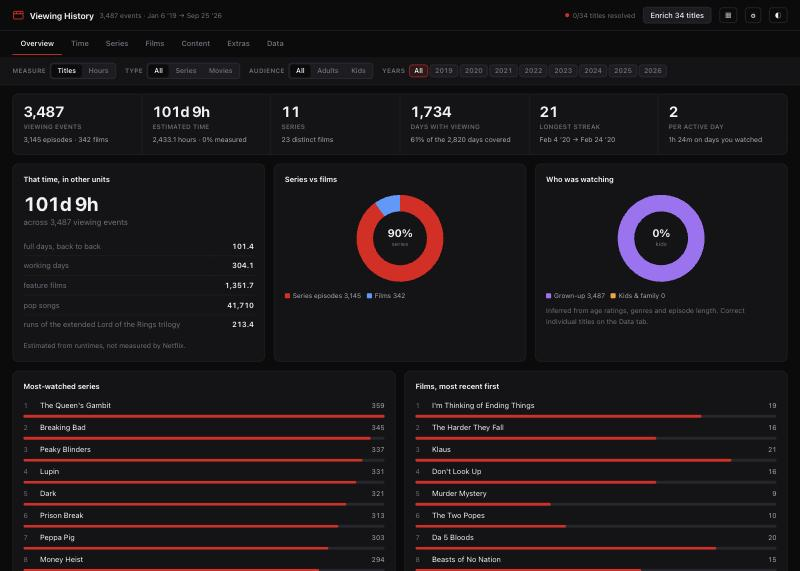
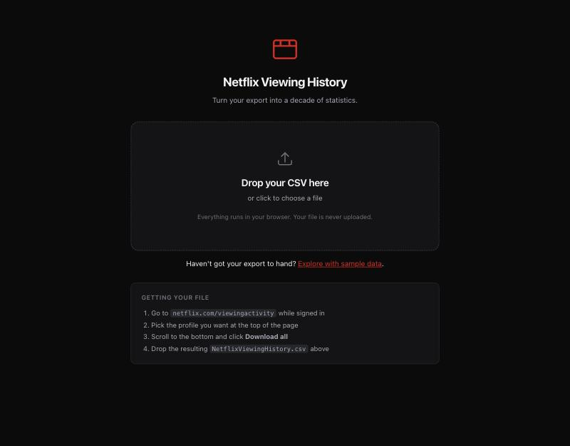
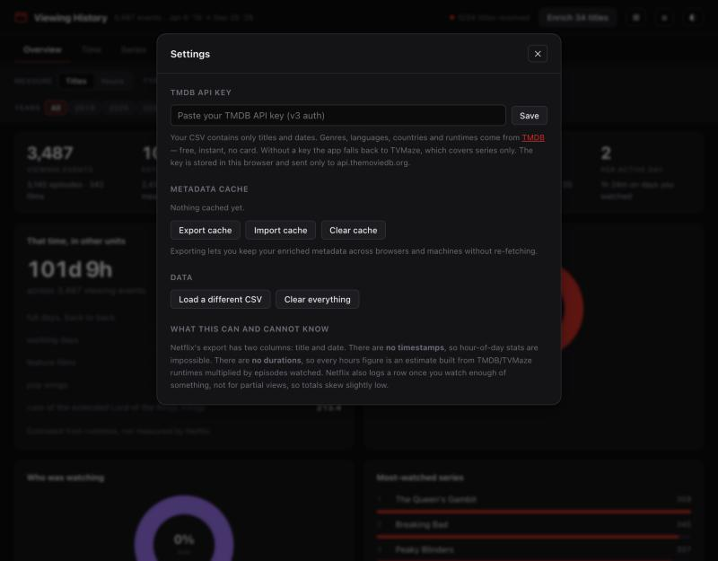
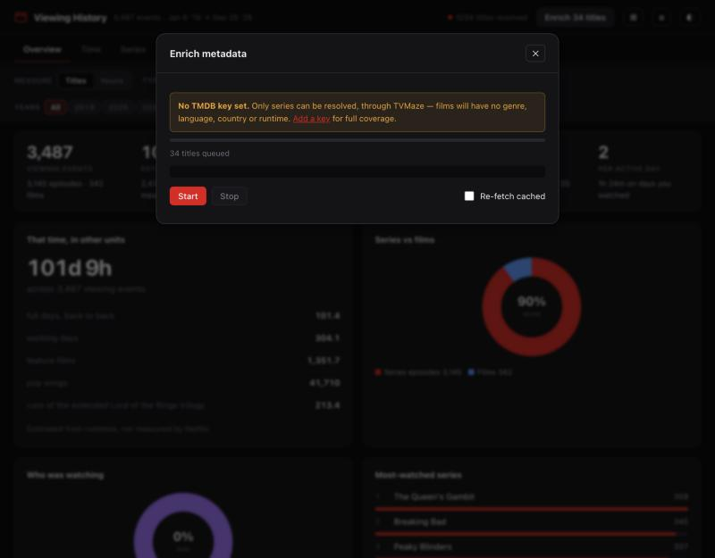

# Netflix Viewing History

Turn the CSV that Netflix gives you into about fifty statistics — years, binges,
genres, languages, countries, streaks and a lot of superlatives.

Everything runs in the browser. Your viewing history is never uploaded anywhere.

**[Open the dashboard →](https://tgebarowski.github.io/netflix-viewing-stats/)**



## What you need to know first

Netflix's export has exactly two columns: **title** and **date**. That is the
whole file. Everything else this dashboard shows is either derived from those
two columns or looked up from a metadata API, and it is worth knowing which is
which before you quote any of it at a party.

- **Hours are estimates, not measurements.** Netflix does not tell you how long
  you watched. Hours are episodes watched multiplied by a runtime from TMDB or
  TVMaze. Where a title never matched, the runtime falls back to the median of
  resolved titles sharing a genre. Every affected card carries an *"N% measured"*
  badge so you can see how much of the figure is real.
- **There are no timestamps.** Dates only. Hour-of-day and late-night stats are
  impossible; "the day you watch most" means a weekday and a calendar date.
- **Partial views are missing.** Netflix logs a row once you have watched enough
  of something, so totals skew slightly low.
- **Series structure is inferred from the title string.** Netflix has used two
  formats over the years — `Show: Season 2: Episode Title` and the older
  `Show: Episode Title`. Both are parsed, and ambiguous single titles are checked
  against TMDB. Anything it gets wrong can be corrected on the **Data** tab.
- **Genre, language and country totals double-count by design.** A title with
  three genres counts in all three, so those totals exceed the number of titles.

---

## Step 1 — Download your viewing history

Netflix keeps this behind a slightly buried page, and the export is **per
profile**, so make sure the right one is selected before you download.

1. Sign in at [netflix.com](https://www.netflix.com) in a desktop browser.
2. Go to **[netflix.com/viewingactivity](https://www.netflix.com/viewingactivity)**.
3. At the top of the page there is a profile selector showing an avatar and a
   name. If your household shares an account, pick the profile whose history you
   want — each profile has its own, and they are not combined.
4. Scroll to the very bottom of the list and click **Download all**.
5. Your browser saves a file called `NetflixViewingHistory.csv`.

It arrives in seconds — this is not the "request all my personal information"
flow, which is a separate feature and takes about 30 days.

The file looks like this, newest first:

```csv
"Title","Date"
"Peaky Blinders: Season 4: Dangerous","9/25/26"
"Glass Onion: A Knives Out Mystery","9/21/26"
```

Now drop it onto the dashboard:



Nothing leaves your machine — the file is read with the browser's `FileReader`
and parsed in a `<script type="module">`. There is no server to upload it to.

> Not ready to use your own data? Click **Explore with sample data** for a
> synthetic 3,487-row history.

## Step 2 — Get a TMDB API key (optional, but it unlocks most of the dashboard)

Without a key the dashboard still works. It falls back to
[TVMaze](https://www.tvmaze.com/api), which is free, needs no signup, and covers
**series only** — so your films get no genre, language, country or runtime, and
the Films and Content tabs stay mostly empty.

A free key from [TMDB](https://www.themoviedb.org/) fixes that. It takes about a
minute and needs no payment details.

1. Create an account at
   **[themoviedb.org/signup](https://www.themoviedb.org/signup)** and verify your
   email address.
2. Go to **[themoviedb.org/settings/api](https://www.themoviedb.org/settings/api)**.
3. Click **Request an API key** and choose **Developer**.
4. Accept the terms, then fill in the short form. For a personal project you can
   put your own name as the application name, this repository's URL (or any URL
   you control) as the application URL, and a one-line description such as
   *"personal viewing-history statistics"*. Approval is instant.
5. The settings page now shows two credentials. **Copy the one labelled
   `API Key`** — a 32-character hexadecimal string. The much longer
   `API Read Access Token` is the v4 credential and this app does not use it.

Paste it into the dashboard under the **⚙** button in the header:



Click **Save**. The key is stored in your browser's local storage and is sent
only to `api.themoviedb.org`. It is never committed, logged, or transmitted
anywhere else — [see for yourself](src/data/metadata.js).

## Step 3 — Enrich

Click **Enrich** in the header. The dashboard looks up every distinct title and
caches the result.



Roughly 700 lookups for a decade of viewing, which takes a couple of minutes
with a key and rather longer without one, since TVMaze is rate-limited harder.
It only has to happen once.

- You can start without a key and add one later — anything fetched during a
  keyless run is automatically re-queued once a key is present.
- **Settings → Export cache** writes a JSON file you can import on another
  browser or machine so you never re-fetch.
- Titles that could not be matched are listed on the **Data** tab, where you can
  also reclassify a film as a series (or vice versa) and move titles between the
  kids and grown-up buckets.

## Using the dashboard

Seven tabs, and four switches above them that apply to everything at once:

| Switch | Effect |
|---|---|
| **Measure** | Recomputes every chart as a count of titles or as estimated hours |
| **Type** | All content, series only, or films only |
| **Audience** | All, grown-up only, or kids only |
| **Years** | Click to isolate a year, click more to add, shift-click to jump to one |

Clicking a genre, language or country filters the whole dashboard by it.
Clicking a bar in most lists opens the viewing events behind it. The **▦**
button hides and shows individual cards, and your layout is remembered.

## Running it locally

```bash
git clone https://github.com/tgebarowski/netflix-viewing-stats.git
cd netflix-viewing-stats
python3 -m http.server 8000
```

Then open <http://localhost:8000>. A server is needed because the app is built
from ES modules, which browsers refuse to load over `file://`.

There is no build step, no package manager and no dependencies.

## How it works

Three layers stacked on top of a two-column CSV:

| Module | Responsibility |
|---|---|
| `src/data/csv.js` | Parses the export, including quoted fields and locale-dependent dates |
| `src/data/classify.js` | Turns title strings into shows, seasons and episodes |
| `src/data/metadata.js` | Resolves titles against TMDB, falling back to TVMaze |
| `src/data/stats.js` | Every aggregation, computed over the filtered row set |
| `src/ui/` | Charts, cards and chrome |

Charts are hand-written SVG — there is no charting library, because the handful
of chart types needed here are a few hundred lines in total and a dependency
would have been the larger half of the project.

Cards are self-registering. A card is an object with an `id`, a `tab`, a width
and a `build(ctx)` that returns a DOM node; dropping a new one into
`src/ui/cards/` and importing it from `src/ui/cards/index.js` is the whole
process of adding a statistic.

```
index.html              markup and panel scaffolding
src/
  core/                 DOM helpers, formatting, storage, the refresh bus
  data/                 parsing, classification, metadata, statistics
  ui/
    cards/              one module per tab
    charts.js           SVG primitives
    ...                 filters, panels, settings, rendering
sample/                 synthetic data for the demo
```

## Deploying your own copy

The included workflow publishes the repository root to GitHub Pages on every
push to `main`. Enable it under **Settings → Pages → Build and deployment →
Source: GitHub Actions**, then update the dashboard link at the top of this file.

Note that a GitHub Actions secret **cannot** be used to ship a shared TMDB key
with a Pages site: Pages serves static files, so anything a workflow writes into
the deployed bundle is readable by every visitor. Each person brings their own
key instead, which is why the field exists in Settings.

## Contributing

Issues and pull requests are welcome. There are no tests and no linter; keep
changes dependency-free and match the surrounding style.

## License

[MIT](LICENSE).

Not affiliated with, endorsed by, or connected to Netflix. Metadata comes from
[TMDB](https://www.themoviedb.org/) and [TVMaze](https://www.tvmaze.com/);
this product uses the TMDB API but is not endorsed or certified by TMDB.
